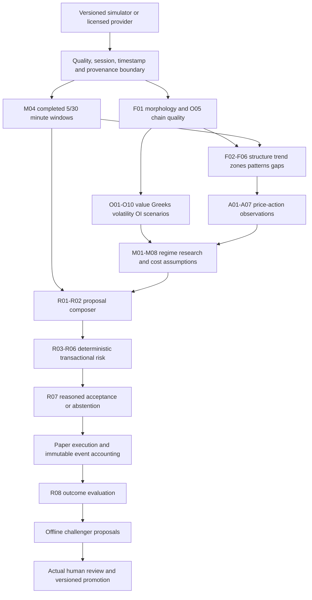

# Skill dependency architecture

Planning revision 1 · 28 October 2026 · Audited application baseline `ff8027ab8a9a54e6eed2deaef895eab91151145f`. These are concrete engineering proposals and source findings, not a claim of implemented intelligence, profitable models, licensed data rights or human approval. Application source, strategies, dependencies and financial history are unchanged by this package.

## Directed dependency order

The graph shows logical phases; resolve detailed dependencies in the catalog. R05 needs an account/equity history from previous events, not current R08 model approval. R03/R04/R06 may deny any proposal; dependency ordering never grants an analytical skill execution access. R07 records a composed result; acceptance still requires the transaction-level risk check immediately before the economic effect. An earlier ACCEPT is not a reusable order token.

## Data and event ordering

1. Freeze the as-of boundary, effective calendar/instrument metadata and provider batch hash.
2. Validate complete source bars and time-aligned option snapshots; reject corrections outside approved policy.
3. Aggregate contiguous completed windows per session. Never infer missing child bars by forward filling.
4. Produce independent observations with their availability times and ambiguity flags.
5. Compose a versioned proposal with alternatives/conflicts. No valid confirmation means INSUFFICIENT_DATA; conflicting adequate evidence means NO_TRADE.
6. Re-read account/kill state and all exposure/reservation limits in the execution transaction. Persist fills, fees, positions, risk response and events atomically.
7. Evaluate after outcomes mature; datasets/labels from later time cannot affect the prior event.

## Dependency failure policy

Quality/calendar failure invalidates dependent observations; a slow optional hypothesis returns UNSUPPORTED rather than a guessed vote. Required dependency timeout/missing output blocks the decision. Nonfinite or contradictory prices are INVALID_DATA, not a zero score. Models unavailable before approval return UNSUPPORTED. A background evaluation failure cannot retroactively rewrite a fill or disable emergency exits. Add bounded DAG-cycle and required-input completeness tests before introducing an orchestrator that runs these contracts.

## Process architecture

Keep the modular monolith and deterministic pure functions first. No Redis/microservice dependency is needed for these contracts. Later durable jobs need job IDs, dataset/source hashes, idempotent completion, retry budgets and cancellation; choose a queue only after measured requirements. Model runtime and broker adapters remain outside the deterministic risk transaction.
