# Trading intelligence architecture

Planning revision 1 · 28 October 2026 · Audited application baseline `ff8027ab8a9a54e6eed2deaef895eab91151145f`. These are concrete engineering proposals and source findings, not a claim of implemented intelligence, profitable models, licensed data rights or human approval. Application source, strategies, dependencies and financial history are unchanged by this package.

## Decision: extend the modular monolith

Preserve React/TypeScript/Vite, Python/FastAPI and SQLite for the credential-free local product. The existing paper package must remain independent from `algooptionx.research` and `algooptionx_harness`; existing architecture tests enforce that boundary. Introduce pure domain contracts only when a scoped task is approved. Retain research modules behind explicit adapters and their current endpoints until compatibility tests justify change. No empty microservices or second orchestration framework is needed.

```mermaid
flowchart LR
  S[Simulator / historical / licensed provider] --> Q[Quality and provenance]
  Q --> F[Point-in-time features and completed windows]
  F --> A[Structure + patterns + options + regime observations]
  A --> D[Versioned decision and abstention composer]
  D --> R[Independent deterministic risk inside transaction]
  R --> X[Paper execution + portfolio + audit event]
  X --> E[Evaluation and immutable dataset lineage]
  E --> C[Offline challenger]
  C --> H[Human-reviewed model promotion / rollback]
```

## Boundaries and ownership

- **Market data:** owns immutable provider batches and metadata versions. Network/auth/provider retries are adapter responsibilities. Source event time, receive time and availability time are distinct.
- **Analytics:** deterministic functions consuming only the frozen observation set; owns versioned feature/skill observations, not account credentials or orders.
- **Decision/strategy:** owns proposal versions, conflicts, insufficient-data and no-trade rationale. No direct SQL writes to cash/positions; no arbitrary natural-language order tool.
- **Risk:** owns cash, limits, session equity basis, kill/data-health checks, exposures/reservations and policy version. Re-evaluates immediately within the economic transaction.
- **Paper execution/accounting:** owns idempotent commands, executable quote assumptions, fills, fees, account/position history and audit chain. Successful outcome and evidence commit together.
- **Evaluation/model governance:** reads frozen decisions and mature outcomes; creates proposed reports/models only. Cannot relabel prior choices or write active-model state without a real promotion decision.
- **User/billing/operations:** future separately designed domains. Tenant IDs/authentication must become trusted server attributes before hosting; no pseudo-tenancy based on client form fields.

## Key contracts and failures

Use the [decision/evidence contracts](decision-contracts.md), [skill DAG](skill-dependencies.md) and [paper integration](paper-integration-design.md). Quality failures and missing required features produce INSUFFICIENT_DATA. Adequate conflicting observations produce NO_TRADE with all alternatives retained. Timeouts cannot become neutral votes. A stale/expired proposal is rejected at execution even if previously eligible. Required schema fields missing means fail closed; extra unrecognized executable instructions are rejected.

Source data corrections create a new batch/version and invalidate dependent pending proposals. Historical events remain immutable with explicit correction records. Session-scoped instrument identity includes effective lot/expiry/strike/right and provider identity; the simulator's fixed LOT must never migrate into a real contract registry by inference.

## Storage and recovery

Prefer additive versioned tables over changing existing event meaning. Candidate new tables: observation_batches, skill_observations, decision_records, risk_decisions and model_proposals; their migration is not implemented by this document. Store money in integer paise, timestamps with explicit UTC representation and source timezone, content hashes and foreign identifiers. Unknown old journal layouts fail with a diagnosis and preserved backup; never DROP history based on pre-release assumptions. A local hash chain is detectable local integrity, not externally anchored nonrepudiation.

Before any write migration: snapshot/backup with server stopped or SQLite's supported backup API, record row counts/hashes, migrate in a transaction with a schema-version journal, verify relationships and restore in a temporary copy. Roll back code compatibly or restore the validated backup during a maintenance window; do not replay a new command twice or overwrite events. Initial runs remain single-process local; durable jobs/queues/Postgres require a measured design and deployment task.

## OpenSpec decision

Current native requirements/ADRs/tasks/schemas are working. Recommend a small compatibility evaluation that maps a sample OpenSpec change to requirement IDs, protected inputs, allowed paths and existing evidence, without adding an unapproved runtime dependency. Acceptance: round-trip traceability, unchanged governance and no duplicate authoritative specifications. Status: proposed evaluation; OpenSpec is not installed or claimed operational.

## Security and trust

Retain credential-free local defaults. Broker read-only adapters receive only scoped secrets outside the model prompt/log; future provider rights and entitlements are externally assessed. Candidate repository code, prompts, reports, skill files and model output are untrusted for human identity/deployment authorization. Existing chat review is procedural, not a cryptographic identity proof. Native read-only independent review is available; the optional unattended CLI and externally enforced release authority remain separately verified capabilities.
